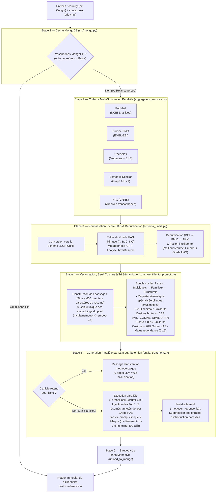

# Architecture & Fonctionnement du Pipeline RAG — UNIDIV

Ce document décrit pas à pas le cheminement complet des données dans le pipeline **UNIDIV**, depuis les **2 variables d'entrée** (`country` et `context`) jusqu'à la génération des **3 paragraphes cliniques** (*Déterminants individuels*, *Déterminants familiaux*, *Déterminants structurels*) et de leurs **sources scientifiques qualifiées (Grade HAS)**.

---

## 1. Schéma global du Pipeline



---

## 2. Détail étape par étape

### Entrées du pipeline (`main(country, context, force_refresh=False)`)
Le point d'entrée est la fonction `main` dans [main.py](file:///c:/Users/Lenovo/OneDrive/Bureau/projets/iackaton-chru-unidiv/main.py#L37). Elle reçoit :
- **`country`** *(str)* : le pays d'origine du patient (ex. `"Congo"`, `"Morocco"`).
- **`context`** *(str)* : la thématique médicale ou anthropologique sélectionnée (ex. `"grieving"`, `"pregnancy"`, `"dental hygiene"`).
- **`force_refresh`** *(bool, optionnel)* : indique s'il faut ignorer et écraser le cache MongoDB.

---

### Étape 1 — Vérification résiliente du cache MongoDB ([src/mongo.py](file:///c:/Users/Lenovo/OneDrive/Bureau/projets/iackaton-chru-unidiv/src/mongo.py))
- Si `force_refresh` vaut `False`, `get_from_mongo(country, context)` interroge la collection `bdd.documents` sur `mongodb://127.0.0.1:27017/` avec un timeout court (`serverSelectionTimeoutMS=2000`).
- Si une synthèse existe déjà pour ce couple `(country, context)`, elle est renvoyée immédiatement en quelques millisecondes sans rappeler les APIs externes.
- Si le service MongoDB local est arrêté, `PyMongoError` est intercepté proprement et le pipeline poursuit son exécution sans cache.

---

### Étape 2 — Collecte documentaire multi-sources en parallèle ([aggregateur_sources.py](file:///c:/Users/Lenovo/OneDrive/Bureau/projets/iackaton-chru-unidiv/src/get_doc_from_site/aggregateur_sources.py))
Contrairement à une approche séquentielle, `collecter_toutes_sources(country, context, sujet="", max_per_source=25)` est appelé **une seule fois** hors de la boucle des déterminants et interroge **5 bases scientifiques simultanément** via `ThreadPoolExecutor` :

1. **PubMed** ([collecte_pubmed_unidiv.py](file:///c:/Users/Lenovo/OneDrive/Bureau/projets/iackaton-chru-unidiv/src/get_doc_from_site/collecte_pubmed_unidiv.py)) : recherche dans `[Title/Abstract]` et `[MeSH Terms]`.
2. **Europe PMC** ([collecte_europepmc.py](file:///c:/Users/Lenovo/OneDrive/Bureau/projets/iackaton-chru-unidiv/src/get_doc_from_site/collecte_europepmc.py)) : recherche biomédicale européenne avec métadonnées complètes (`resultType=core`).
3. **OpenAlex** ([collecte_openalex.py](file:///c:/Users/Lenovo/OneDrive/Bureau/projets/iackaton-chru-unidiv/src/get_doc_from_site/collecte_openalex.py)) : base mondiale pluridisciplinaire (médecine + anthropologie + sociologie), avec reconstruction des résumés depuis l'index inversé.
4. **Semantic Scholar** ([get_doc_from_semantic-scholar.py](file:///c:/Users/Lenovo/OneDrive/Bureau/projets/iackaton-chru-unidiv/src/get_doc_from_site/get_doc_from_semantic-scholar.py)) : graphe de publications scientifiques.
5. **HAL (CNRS)** ([collecte_hal.py](file:///c:/Users/Lenovo/OneDrive/Bureau/projets/iackaton-chru-unidiv/src/get_doc_from_site/collecte_hal.py)) : archives ouvertes francophones et sciences humaines et sociales.

> **Tolérance aux pannes** : chaque collecteur est isolé dans un bloc `try/except`. Si une API externe est lente ou indisponible, elle est ignorée sans faire échouer les 4 autres.

---

### Étape 3 — Schéma JSON Unifié, Score HAS & Déduplication ([schema_unifie.py](file:///c:/Users/Lenovo/OneDrive/Bureau/projets/iackaton-chru-unidiv/src/get_doc_from_site/schema_unifie.py))

#### 3.1. Normalisation et calcul du Grade HAS (`construire_notice_unifiee` & `evaluer_grade_has`)
Chaque article collecté est converti dans un format JSON unique et reçoit un objet `recommendation_score` selon la grille de la **Haute Autorité de Santé (HAS)** en croisant les métadonnées de l'API (`publication_types`, `mesh_terms`) et une détection méthodologique bilingue (FR/EN) dans le titre et le résumé :
- **Grade A (Niveau 1 — score `100`)** : essais comparatifs randomisés (ECR/RCT), méta-analyses.
- **Grade B (Niveau 2 — score `75`)** : études de cohortes prospectives, études comparatives non randomisées.
- **Grade C (Niveau 3 — score `50`)** : études cas-témoins.
- **Grade C (Niveau 4 — score `35`)** : études rétrospectives, séries de cas, études transversales descriptives.
- **Grade NC (Qualitatif — score `45` / Non spécifié — score `20`)** : études ethnographiques, phénoménologiques ou entretiens qualitatifs.

#### 3.2. Déduplication et fusion intelligente (`dedupliquer_et_fusionner_articles`)
Les articles provenant des 5 sources sont comparés selon 3 clés successives : **DOI normalisé** $\rightarrow$ **PMID** $\rightarrow$ **Titre normalisé**.
Lorsqu'un doublon est détecté entre deux bases (ex. PubMed et OpenAlex) :
- Les provenances sont combinées (`"source": "PubMed · OpenAlex"`).
- Le résumé (`abstract`) le plus long et complet est conservé.
- Les descripteurs MeSH et types de publication sont fusionnés, et **le meilleur Grade HAS est conservé**.
- Le corpus unifié est sauvegardé dans `data/raw/aggregated_<country>_<context>.json`.

---

### Étape 4 — Vectorisation & Sélection du Top 5 par Déterminant ([compare_title_to_prompt.py](file:///c:/Users/Lenovo/OneDrive/Bureau/projets/iackaton-chru-unidiv/src/compare_title_to_prompt.py))

Pour orienter finement la sélection vers chacun des **3 déterminants** sans perdre d'articles au moment de la recherche API :

1. **Construction des passages riches** : dans [main.py](file:///c:/Users/Lenovo/OneDrive/Bureau/projets/iackaton-chru-unidiv/main.py#L28-L34), chaque article est représenté par son **titre + les 600 premiers caractères de son résumé** (`_construire_passage_embedding`).
2. **Vectorisation unique du pool (cache mémoire)** : le modèle `nvidia/nemotron-3-embed-1b` (avec `input_type="passage"`) calcule une seule fois les vecteurs d'embeddings de tous les articles du pool et les garde en cache (`_PASSAGES_EMBEDDING_CACHE`).
3. **Boucle sur les 3 déterminants** (`individuels`, `familiaux`, `structurels`) :
   - Pour chaque déterminant, on formate sa requête sémantique bilingue définie dans [src/config.py](file:///c:/Users/Lenovo/OneDrive/Bureau/projets/iackaton-chru-unidiv/src/config.py#L7-L29) (`EMBEDDING_QUERY_INDIVIDUELS`, `EMBEDDING_QUERY_FAMILIAUX`, `EMBEDDING_QUERY_STRUCTURELS`) et on calcule son vecteur avec `input_type="query"`.
   - On calcule un **score hybride** pour chaque article :
     $$\text{Score} = 0.80 \times \text{Similarité Cosinus} + 0.20 \times \left(\frac{\text{score\_numerique\_HAS}}{100}\right) - \text{Malus de redondance}$$
   - Le **malus de redondance (`-0.15`)** s'applique aux articles déjà sélectionnés par un déterminant précédent (`already_selected_indices`), afin que chaque paragraphe s'appuie sur des articles variés et spécifiques.
   - **Filtrage par seuil minimal (`MIN_COSINE_SIMILARITY = 0.28`)** : tout article dont la **similarité cosinus brute** est inférieure à `0.28` est automatiquement écarté, même s'il figure dans le Top 5.
   - Entre **0 et 5 articles véritablement pertinents** (`top_5`) sont ainsi retenus pour le déterminant en cours.

---

### Étape 5 — Génération parallèle des 3 paragraphes par le LLM ou Abstention ([src/ia_treatment.py](file:///c:/Users/Lenovo/OneDrive/Bureau/projets/iackaton-chru-unidiv/src/ia_treatment.py) & [main.py](file:///c:/Users/Lenovo/OneDrive/Bureau/projets/iackaton-chru-unidiv/main.py))

Les 3 déterminants sont générés **en parallèle** via `ThreadPoolExecutor(max_workers=3)` :
1. **Abstention méthodologique (si 0 article retenu)** :
   - Si aucun article n'a franchi le seuil `MIN_COSINE_SIMILARITY` pour un déterminant, **le LLM n'est pas appelé** (0 % d'hallucination) et un message d'abstention clinique explicite est retourné.
2. **Formatage des sources avec leur niveau de preuve (`_formater_source_pour_prompt`)** :
   Chaque article retenu (1 à 5) est injecté sous la forme :
   ```text
   --- ARTICLE 1 [Grade HAS : B (Niveau 2) — Présomption scientifique (Niveau 2) | Méthode : Cohort Studies] ---
   <Résumé scientifique complet de l'article>
   ```
2. **Assemblage avec le prompt clinique et éthique** (`PROMPT_DET_INDIVIDUELS`, `PROMPT_DET_FAMILIAUX`, `PROMPT_DET_STRUCTURELS` dans [src/config.py](file:///c:/Users/Lenovo/OneDrive/Bureau/projets/iackaton-chru-unidiv/src/config.py#L31-L59)) :
   - Impose un ton médical, empathique, respectueux des droits humains, sans généralisation abusive, et basé exclusivement sur les sources fournies.
3. **Appel au modèle `nvidia/nemotron-3.5-lightning-30b-a3b`** via l'API NVIDIA NIM en streaming.
4. **Nettoyage automatique (`_nettoyer_reponse_ia`)** : retire toute phrase méta-introductive éventuelle (*« Le paragraphe suivant est élaboré selon... »*) ou titre redondant pour ne livrer que le paragraphe clinique pur.

---

### Étape 6 — Assemblage final & Persistance MongoDB ([main.py](file:///c:/Users/Lenovo/OneDrive/Bureau/projets/iackaton-chru-unidiv/main.py#L87-L110))

Les 3 paragraphes générés (`res[0]`, `res[1]`, `res[2]`) et leurs 3 listes de 5 références (`top5s[0]`, `top5s[1]`, `top5s[2]`) sont assemblés dans le dictionnaire final `resultat_def` :

```json
{
  "country": "Congo",
  "context": "grieving",
  "text": {
    "determinant_individuels": "Paragraphe sur les déterminants individuels...",
    "determinant_familiaux": "Paragraphe sur les déterminants familiaux...",
    "determinant_structurels": "Paragraphe sur les déterminants structurels..."
  },
  "references": {
    "determinant_individuels": [ /* 5 notices unifiées avec recommendation_score */ ],
    "determinant_familiaux": [ /* 5 notices unifiées avec recommendation_score */ ],
    "determinant_structurels": [ /* 5 notices unifiées avec recommendation_score */ ]
  },
  "_id": "ObjectId(...)"
}
```

- Si `force_refresh=True`, `delete_from_mongo(country, context)` supprime d'abord l'ancienne entrée.
- `upload_to_mongo(resultat_def)` enregistre la nouvelle synthèse dans MongoDB, puis `main()` retourne `resultat_def` au serveur HTTP ([server.py](file:///c:/Users/Lenovo/OneDrive/Bureau/projets/iackaton-chru-unidiv/server.py)) qui l'affiche dans le front-end.
